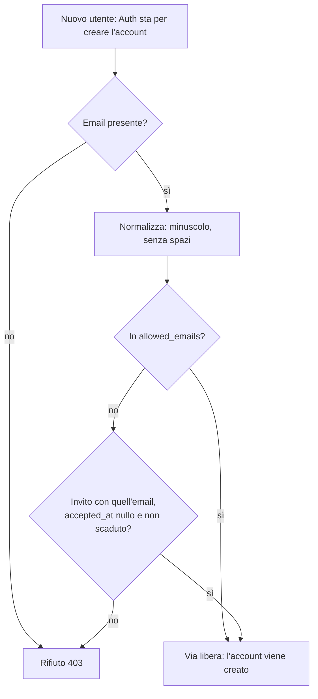
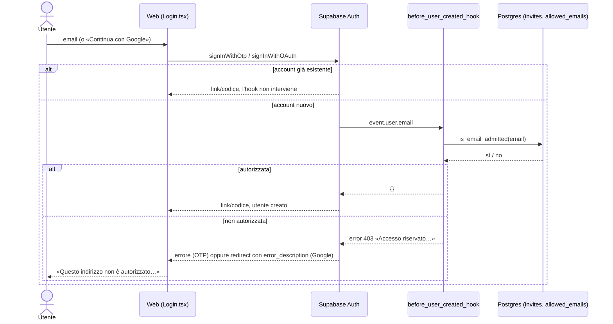
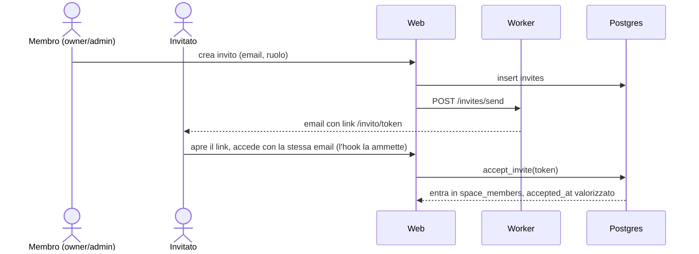

# Accesso chiuso: allowlist email + inviti

## Problema
Ohana è esposta su ohanapp.org ma è privata. Prima della migrazione 0025 chiunque inserisse un'email nella pagina di login creava un account Supabase (`signInWithOtp` e Google creano l'utente se manca). La RLS isolava i dati, ma il servizio restava aperto.

## Scelta
Hook **Before User Created** di Supabase Auth, non `enable_signup = false` e non Cloudflare Access.
- `enable_signup = false` bloccherebbe anche l'invitato nuovo, che crea l'account al primo accesso.
- Cloudflare Access aggiungerebbe un secondo login e non protegge il backend Supabase, raggiungibile con la anon key.

## Regole di ammissione


## Login (OTP o Google)


## Invito e ingresso nello spazio

Dopo l'accettazione l'invito non ammette più nuove registrazioni con quell'email, ma l'account esiste già.

## Rischi e gestione
- **Google con email diversa dall'invito**: l'hook guarda l'email del provider; se non coincide viene rifiutata. Va invitato l'indirizzo Google effettivo.
- **Invito scaduto o già accettato**: non ammette; serve un nuovo invito o una riga in `allowed_emails`.
- **Maiuscole e spazi**: confronto con `lower(trim(...))` su entrambi i lati.
- **Utenti esistenti**: l'hook scatta solo alla creazione, il loro accesso non cambia.
- **Hook che fallisce**: Auth rifiuta la registrazione (fallisce chiuso). Chi ha già un account non è toccato.
- **Funzioni esposte**: `before_user_created_hook` ha `execute` solo per `supabase_auth_admin`; `is_email_admitted` e `allowed_emails` non sono accessibili ad `anon`/`authenticated` (verificato in `supabase/tests/isolation.sql`).

## Da configurare a mano (progetto online)
1. Applicare la migrazione `0025_closed_signup.sql`.
2. (In `config.toml` l'hook è spento perché gli e2e accedono con email casuali.) Dashboard Supabase → Authentication → Hooks → *Before User Created* → tipo Postgres, funzione `public.before_user_created_hook`, abilita. (`config.toml` vale solo per il Supabase locale.)
3. Inserire gli indirizzi da autorizzare nello SQL editor, **prima** di invitare nessuno e senza metterli nel repo:
   ```sql
   insert into public.allowed_emails (email, note) values ('indirizzo@esempio.it', 'bootstrap');
   ```
   L'email va scritta in minuscolo e senza spazi (c'è un vincolo `check`).
4. Verifica: da una finestra anonima, chiedi il link con un'email non autorizzata e controlla il messaggio «Questo indirizzo non è autorizzato…».
